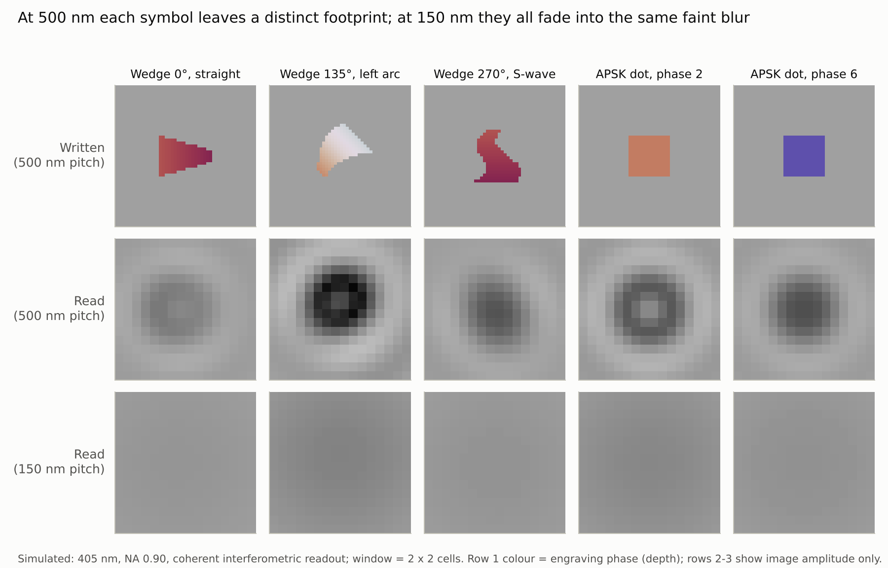
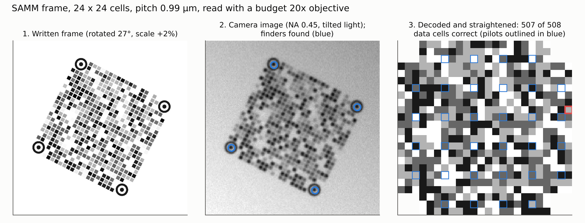

# 4D-VODS

[](https://doi.org/10.5281/zenodo.24268721)
[](https://github.com/GuettHM/4d-vods/actions/workflows/tests.yml)

**Optical data storage in glass with a self-aligning code for low-cost readers – an open simulation study**

Hakim Guettal · v1.1.0 · Code: MIT · Documents and figures: CC BY 4.0

*I am not a professional physicist. 4D-VODS started as a geometric intuition (storing data in the shape of engraved symbols) and grew into this conceptual study and simulator, built with the help of AI tools on standard diffraction optics. Corrections from specialists are very welcome.*

4D-VODS is a concept for archival data storage on a glass plate with two kinds of region
written by the same femtosecond laser:

- a **high-density data layer** of multi-level dots in a metallised relief sealed under a
  cover layer, read by a laboratory interferometric microscope;
- a **Self-Aligning Micro-Matrix (SAMM)** code, ablated in a thin absorbing film, that an
  ordinary bright-field microscope camera can find, orient and decode at any rotation,
  with no positioning stage.

The project page is at **https://guetthm.github.io/4d-vods/**. This repository contains the
simulator, the raw results behind every number, and two documents:
[White Paper v1.1](docs/4D-VODS_White_Paper_v1.1.pdf) and
[Technical Note TN-001 rev. 1.1](docs/4D-VODS_Technical_Note_TN-001.pdf).
Corrections to earlier versions are listed in [ERRATA.md](ERRATA.md).

> **Status: concept, simulation only (TRL 2).** No physical sample has been written or read.
> The results compare design options under the same modelled physics; they are not
> performance claims for a device.



## Key results

**Data layer** (405 nm, NA 0.90, interferometric readout, 10% writing variability, practical decoder).
Densities are the information recovered **before error correction**:

| Alphabet | Best pitch | Information before error correction | ≈ Per 12 cm disc layer |
| --- | --- | --- | --- |
| Naive estimate: 8-bit Voxel-Wedge at 150 nm | 150 nm | 356 bits/µm² (not achievable) | 390 GB |
| **APSK-16 dots (0.6 p square, 4 bits)** | 300 nm | **42.6 bits/µm²** (± 0.07) | 47 GB |
| Voxel-Wedge (8 bits) | 500 nm | 26.8 bits/µm² (± 0.15) | 29 GB |

For comparison, the **net user data** of optical discs with the same 405 nm optics is
22.8 bits/µm² for a 25 GB Blu-ray layer and 30.5 bits/µm² for a 33.4 GB BDXL layer.
After pilots (1 in 16) and the planned error-correction overhead (about 12%), APSK-16 would
give roughly **35 bits/µm² of user data, about 1.15× BDXL** – an estimate until the
error-correction budget (test T2) is simulated.

± = standard deviation over 5 further random seeds (`results/spread.json`). The ranking holds
at 5%, 10% and 20% writing variability (`figures/fig7_sensitivity.png`).

**SAMM layer** (bright-field intensity camera, random rotation 0–360°, scale ±3%,
illumination tilt ±20%, pitch 1.1 × λ/NA, 200 frames per reader):

| Reader | NA | Pitch at 405 nm | Frames aligned (95% CI) | Symbol error | Net density at 405 nm |
| --- | --- | --- | --- | --- | --- |
| Entry-level 10× objective | 0.25 | 1.78 µm | 200/200 (98.1–100%) | 0.02% | 0.55 bits/µm² (≈ 7 MB/cm²) |
| Budget 20× objective | 0.45 | 0.99 µm | 199/200 (97.2–99.9%) | 0.25% | 1.77 bits/µm² (≈ 22 MB/cm²) |
| Budget 40× objective | 0.65 | 0.69 µm | 200/200 (98.1–100%) | 0.02% | 3.75 bits/µm² (≈ 47 MB/cm²) |

The SAMM image depends only on the pitch in units of λ/NA (checked in
[docs/VALIDATION.md](docs/VALIDATION.md)), so alignment and error rates hold for any
wavelength. With white-LED light (about 550 nm) the pitches in µm grow by 550/405 and the
densities shrink by about 0.54×.



Other findings:

- Shape-encoded bits (azimuth, curvature) disappear first as the pitch shrinks; phase and
  reflectance survive down to 300 nm (`fig2`).
- Pilot symbols handle rotation with about 3× fewer errors than differential angle coding (`fig3`).
- Software compression before writing beats on-media run-length glyphs 4–6× on real data (`fig4`).

## Quick start

```bash
pip install -r requirements.txt          # or the exact versions: requirements-lock.txt
pytest -q                                # ~50 tests, about 1 minute

python -m vods validate --report         # physics checks -> docs/VALIDATION.md
python -m vods check                     # every published number vs results/ and the documents
python -m vods manifest                  # provenance of every result file

python -m vods run datalayer --config configs/quick.toml     # smoke runs -> results_quick/
python -m vods run samm --config configs/quick.toml

python -m vods run datalayer --config configs/datalayer.toml # full data-layer study (~30 min)
python -m vods run samm --config configs/samm.toml           # full SAMM study (~30 min)
python -m vods run samm --config configs/samm_sensitivity.toml
python -m vods figures                   # figures/ (PNG, PDF, CSV) + results/summary.json
```

Random seeds are fixed, so a full run reproduces the published results. The scripts in
`sim/` can still be run directly as in v1.0 (`python3 sim/samm_sim.py`, …).

## How the results are kept honest

| Check | What it guarantees | Where |
| --- | --- | --- |
| Validation | The optics and statistics match closed-form results and independent libraries (Airy pattern, circular-pupil MTF, Parseval, scale invariance, exact mutual information, SciPy confidence intervals) | `vods/validation.py`, [docs/VALIDATION.md](docs/VALIDATION.md) |
| Provenance | Every file in `results/` has its hash, command, parameters, commit and software versions; a hand-edited result fails the tests | `results/MANIFEST.json` |
| Published numbers | Every number quoted in the README, the project page and the documents is traced to a field of a result file and checked against the text | `results/claims.json` |
| Regression | Fixed seeds give the same values on every Python and NumPy version tested | `tests/test_regression.py` |
| Properties | SAMM decodes at 0°, 90°, 180°, 270° and mirrored; errors grow with noise and with smaller pitch | `tests/test_properties.py` |
| Continuous integration | All of the above on Python 3.11–3.13, plus style checks and the exact reference environment | `.github/workflows/tests.yml` |

## Repository layout

| Path | Contents |
| --- | --- |
| `sim/vods_sim.py` | Data-layer simulator: Voxel-Wedge vs APSK-16, ideal and practical decoders, rotation, Gray coding, compression, sensitivity |
| `sim/samm_sim.py` | SAMM simulator: finder detection, alignment, decoding, confidence intervals, sensitivity |
| `sim/make_figures.py`, `sim/make_illustrations.py`, `sim/plotstyle.py` | Figures in one shared style |
| `vods/` | Command line (`python -m vods`), provenance, validation checks, published-number checks |
| `configs/` | Parameters of every published run (TOML) |
| `results/` | Raw JSON results, `MANIFEST.json` (provenance), `claims.json` (published numbers) |
| `figures/` | Figures as PNG and PDF; `figures/data/` holds the plotted values as CSV |
| `docs/` | White Paper, Technical Note (PDF and Markdown source), validation report |
| `tests/` | Unit, validation, regression, property and consistency tests |
| `ERRATA.md`, `CHANGELOG.md`, `HISTORY.md` | Corrections, version history, how the design evolved |

## What is modelled, and what is not

Modelled: scalar Fourier optics at the diffraction limit (coherent for the data layer,
incoherent for SAMM), shot and sensor noise, writing variability, inter-symbol interference,
random rotation, scale and illumination errors, practical decoders.

Not modelled: real laser–glass interaction and shape fidelity, vectorial optics at high NA,
defocus and tilt, lens distortion and colour sensors, multilayer cross-talk,
error-correction codes, speed and cost. See section 16 of the white paper and
[ERRATA.md](ERRATA.md) (E4) for the physical medium each result applies to.

## Related work

Microsoft Project Silica (Nature, 2026), 5D optical storage (University of Southampton),
Cerabyte ceramic storage, Blu-ray and BDXL, holographic storage, and 2D codes such as QR,
Data Matrix and Aztec. 4D-VODS builds on these ideas; its contribution is an open,
reproducible comparison and a low-cost, self-aligning reading layer. See section 5 of the
white paper.

## How to cite

Use the "Cite this repository" button on GitHub (from `CITATION.cff`) or:

> Guettal, H. (2026). *4D-VODS: optical data storage in glass with a self-aligning code for low-cost readers* (v1.1.0). Zenodo. https://doi.org/10.5281/zenodo.24268721

This concept DOI always resolves to the latest version. To cite one exact version:

| Version | DOI |
| --- | --- |
| 1.1.0 | https://doi.org/10.5281/zenodo.24275029 |
| 1.0.0 | https://doi.org/10.5281/zenodo.24268722 |

## Use of AI tools

AI assistants helped write the simulator and documents (see the note at the top). Every
result comes from the code in this repository and can be checked by re-running it.

## Contributing

Corrections are the most useful contribution: see [CONTRIBUTING.md](CONTRIBUTING.md) and the
[physics correction](https://github.com/GuettHM/4d-vods/issues/new?template=physics_correction.yml)
issue form. Please follow the [code of conduct](CODE_OF_CONDUCT.md).
