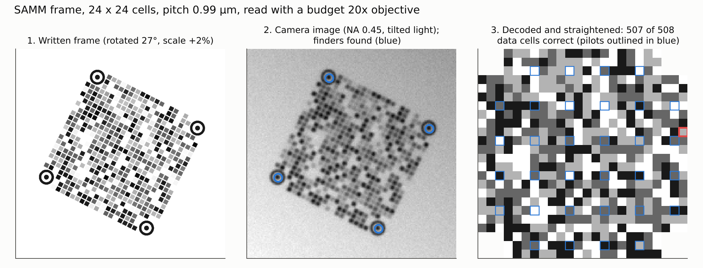
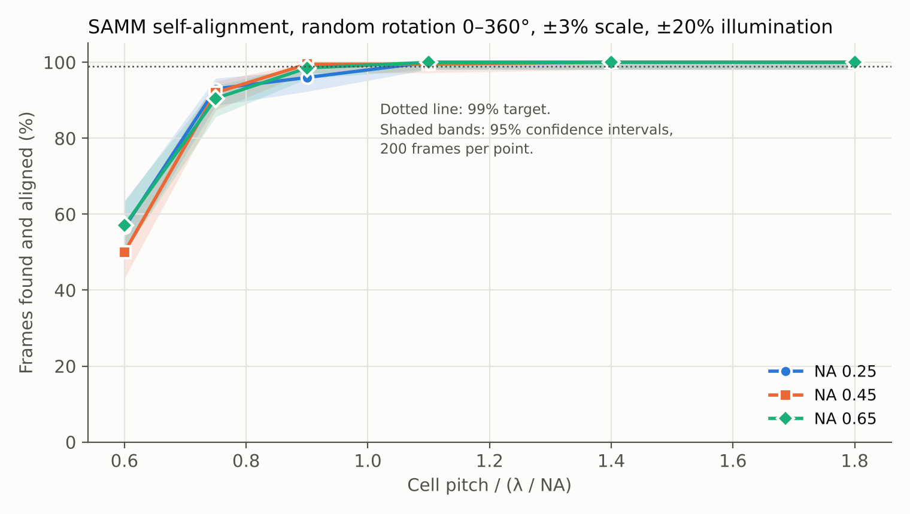

# 4D-VODS Technical Note TN-001

System specification rev. 1.1 – data layer and self-aligning micro-matrix (SAMM) layer

**Hakim Guettal** · Revision 1.1, November 2026 · Text: CC BY 4.0 · Code: MIT License

*I am not a professional physicist. 4D-VODS started as a geometric intuition (storing data in the shape of engraved symbols) and grew into this conceptual study and simulator, built with the help of AI tools on standard diffraction optics. Corrections from specialists are very welcome.*

Nov 15, 2026 · @Hakim

## 1. Scope and status

This note specifies the formats, parameters and tests for a first 4D-VODS prototype: a glass medium with a high-density data layer and a self-aligning micro-matrix (SAMM) layer readable by low-cost microscopes. It is revision 1.1, issued before the project starts; values marked *simulated* come from the open simulator, values marked *target* are design goals, and values marked *TBD* need measurement.

- **Companion document:** *4D-VODS White Paper v1.1* (motivation, applications, full results).

- **Normative language:** "shall" marks a requirement for the prototype; "should" marks a recommendation.

- **Out of scope:** commercial reader design, robotics, cost model, multilayer stacking beyond two layers.

## 2. Terms and abbreviations

| Term        | Meaning                                                                                        |
|-------------|------------------------------------------------------------------------------------------------|
| APSK-16     | Amplitude and phase-shift keying with 16 states: 8 phase (depth) levels × 2 reflectance levels |
| Cell        | One lattice site; holds one symbol                                                             |
| DARP        | Differential angular readout: data in the angle change between consecutive symbols             |
| Finder      | Rotation-invariant bullseye in each SAMM frame corner                                          |
| Frame       | Square block of cells decoded as one unit                                                      |
| Gray code   | Bit mapping in which adjacent levels differ by one bit                                         |
| LDPC / RS   | Low-density parity-check / Reed-Solomon error-correcting codes                                 |
| NA          | Numerical aperture of the objective                                                            |
| p           | Cell pitch (centre-to-centre spacing)                                                          |
| Pilot       | Cell with a known level, used for orientation and calibration                                  |
| SAMM        | Self-Aligning Micro-Matrix: the low-cost readable layer                                        |
| SER / BER   | Symbol / bit error rate                                                                        |
| Voxel-Wedge | Asymmetric 8-bit symbol (azimuth, depth-slope, curvature, reflectance)                         |
| λ           | Read wavelength, 405 nm unless stated                                                          |

## 3. System overview

One femtosecond-laser writer makes both layers on the same glass plate (media declared in section 6); two classes of reader recover them.

| Component         | Prototype specification                                                                               | Status    |
|-------------------|-------------------------------------------------------------------------------------------------------|-----------|
| Medium            | Fused silica or borosilicate plate, 25 × 25 mm, 1–2 mm thick                                          | Target    |
| Writer            | Femtosecond laser, single pulse per symbol, beam shaping for depth/phase levels, closed-loop XY stage | Target    |
| Laboratory reader | Interferometric (amplitude and phase), 405 nm, NA 0.90, 8 × 8 camera pixels per symbol, XY stage      | Simulated |
| Low-cost reader   | Bright-field camera, 405 nm LED or laser diode, NA 0.25–0.65, no stage, any orientation               | Simulated |
| Decoder software  | Template matching + interference cancellation (data layer); finder correlation + pilot fit (SAMM)     | Simulated |

Data flow: user files → software compression → encryption (optional) → error-correction coding → symbol mapping → frames → writing. Reading reverses the chain; the SAMM layer is read first because it holds the index and format description.

## 4. Data layer specification

The data layer shall use APSK-16 dots (0.6 p squares) on a 300 nm square lattice, 4 bits per cell, read interferometrically.

**4.1 Symbol.** A square dot of side 0.6p (180 nm at p = 300 nm). Phase level k (0–7) sets the round-trip phase φk = 2πk/8 + π/8; reflectance level r (0–1) sets the floor amplitude to 1.0 or 0.5.

*h*ₖ = φₖ λ / (4π *n*) = (*k* + 0.5) λ / (16 *n*),  *k* = 0, …, 7

In air (n = 1) and at 405 nm this gives depths of 12.7, 38.0, 63.3, 88.6, 113.9, 139.2, 164.5 and 189.8 nm. Inside glass the physical depth scales with the local index change n, which is TBD.

**4.2 Bit mapping.** Symbol bits \[b3 b2 b1 \| b0\]: b3–b1 select the phase level through a 3-bit Gray code (adjacent phases differ by one bit); b0 selects the reflectance.

| b3 b2 b1      | 000 | 001 | 011 | 010 | 110 | 111 | 101 | 100 |
|---------------|-----|-----|-----|-----|-----|-----|-----|-----|
| Phase level k | 0   | 1   | 2   | 3   | 4   | 5   | 6   | 7   |

**4.3 Frame.** 64 × 64 cells (19.2 µm square at 300 nm). Cells whose row and column are both ≡ 2 (mod 4) are pilots with known levels (1 in 16, 256 per frame); they give rotation, gain and phase reference. The frame size is a target; the simulation used 7 × 7 patches.

**4.4 Error correction.** Target: an inner soft-decision LDPC code of rate ≈ 0.94 per frame, and an outer Reed-Solomon RS(255, 239) code interleaved across frames so that a scratch spanning several frames is recoverable. Overall code rate 0.94 × 239/255 ≈ 0.88, i.e. about 12% parity, within the 15% limit of test T2. Revision 1.0 proposed rate 0.9 with RS(255, 223), which gives 21% parity and could not pass T2 (ERRATA.md, E3). Not yet simulated.

**4.5 Robust mode (Voxel-Wedge).** For media written at 500–600 nm pitch, the 8-bit Voxel-Wedge may be used: azimuth (3 bits, 8 orientations 45° apart, Gray coded), depth stratum 40/90 nm × ramp direction (2 bits), tail curvature straight / left / right / S (2 bits), floor reflectance (1 bit). Geometry scales with pitch: length 0.75p, head 0.6p, tail 0.17p, tail deflection 0.12p. It shall not be used below 500 nm (white paper, Result 2).

## 5. SAMM layer specification

A SAMM frame shall be decodable by an intensity-only camera at any rotation, at ±3% scale error and with ±20% illumination tilt, without a positioning stage.

*Figure 1: one simulated SAMM-24 frame at 0.99 µm pitch (NA 0.45 reader). The four bullseye finders are found by correlation, the pilots fix the orientation, and 507 of 508 data cells are recovered (sim/make_illustrations.py).*

**5.1 Frame geometry (SAMM-24, simulated).**

| Parameter    | Value                                                                     |
|--------------|---------------------------------------------------------------------------|
| Frame size   | 24 × 24 cells                                                             |
| Finder cells | 4 × (3 × 3) = 36, one block per corner                                    |
| Pilot cells  | 32: every cell whose row and column are both ≡ 2 (mod 4), outside finders |
| Data cells   | 508 (88.2% of the frame)                                                  |
| Payload      | 508 × 2 bits = 1,016 bits = 127 bytes before error correction             |
| Quiet zone   | ≥ 1 cell of unwritten substrate around the frame (target)                 |

**5.2 Finder.** Centred in its 3 × 3 block. Written dark (reflectance 0.1) where r \< 0.45p or 0.95p \< r \< 1.4p, r being the distance from the block centre; unwritten elsewhere. The pattern is invariant to rotation, so it is detected with a single normalised correlation.

**5.3 Pilots.** Pilot levels follow a fixed pseudo-random sequence (simulator: numpy default_rng, seed 123, integers 0–3 over the 24 × 24 grid, read at pilot positions). The sequence is not symmetric under 90° rotation or mirroring, which is what lets the decoder pick the right corner assignment.

**5.4 Data cells.** Square dot of side 0.8p, centred in the cell. Four reflectance levels, Gray coded:

| Level         | Reflectance | Bits |
|---------------|-------------|------|
| 0 (unwritten) | 1.0         | 00   |
| 1             | 0.7         | 01   |
| 2             | 0.4         | 11   |
| 3             | 0.1         | 10   |

Data cells are filled in row-major order, skipping finders and pilots, origin at the corner identified by the pilots.

**5.5 Pitch rule.** The writer shall choose the pitch for the weakest reader the frame must serve:

*p* = 1.1 × λ / NAₓ,  where NAₓ is the numerical aperture of the weakest reader to be served

| Reader class              | NA   | Pitch at 405 nm | Frame side (24 cells) |
|---------------------------|------|-----------------|-----------------------|
| Entry-level 10× objective | 0.25 | 1.78 µm         | 42.8 µm               |
| Budget 20× objective      | 0.45 | 0.99 µm         | 23.8 µm               |
| Budget 40× objective      | 0.65 | 0.69 µm         | 16.4 µm               |

At 1.1 × λ/NA, 599 of 600 simulated frames aligned. Where a frame must never need re-imaging, the writer should use 1.4 × λ/NA: no failure in 600 simulated frames, at about 62% of the density.

Pitches above are at 405 nm. The SAMM image depends only on the pitch in units of λ/NA (validated in the repository), so the rule holds at any wavelength; with white-LED light (about 550 nm) the pitch at NA 0.25 is 2.42 µm. Many low-cost USB microscopes have an NA below 0.25 and need a correspondingly larger pitch.

*Figure 2: share of frames found and aligned against pitch, 200 randomly rotated frames per point; shaded bands are 95% confidence intervals (results/samm.json, figures/data/fig5_samm_alignment.csv).*

**5.6 Payload format (target, not simulated).** Byte 0: format version. Bytes 1–4: frame number. Byte 5: payload length. Bytes 6–118: payload. Bytes 119–126: error-correction parity (e.g. RS(127, 119) over GF(2⁸) shortened, correcting 4 byte errors). Frames carrying the same file are numbered consecutively so the reader can scan them in any order.

**5.7 Optional wedge key.** A 3 × 3-cell asymmetric wedge may replace one finder to give the orientation from a single corner when only part of a frame is visible. Not simulated.

## 6. Media layout and bootstrap zone

The medium is organised so that a reader with no prior knowledge can work outwards from something visible to the naked eye. All values here are targets.

1.  **Visible marker.** A millimetre-scale mark, readable by eye, points to the bootstrap zone.

2.  **Bootstrap zone.** SAMM frames written for NA 0.25 (1.78 µm pitch) carrying this specification in plain text, the decoder in pseudocode, and the media index. An entry-level microscope (NA 0.25) reads it.

3.  **Index zone.** SAMM frames for NA 0.45 or 0.65 listing every file: name, data-layer address, length, checksum.

4.  **Data zone.** Data-layer frames (APSK-16, 300 nm), addressed on a fixed grid of frame positions, each starting with a header that holds its frame number.

**Media (declared in revision 1.1).** The SAMM layer shall be a thin absorbing film (metal, nitride or ceramic) on the glass surface, removed by laser ablation; grey levels are set by the ablated fraction of each cell, in features finer than the reader resolves, so that a bright-field camera sees amplitude contrast. The film shall be protected by a durable material or a bonded cover glass (TBD). The data layer is specified, and simulated, as a reflective relief: a metallised relief sealed under a cover layer of index n, with the depths hₖ of section 4.1. Further data layers would need partly reflecting layers, as in multilayer optical discs (TBD). Eight phase levels written inside bulk glass are out of scope: with an index change of 0.005–0.02 the deepest level needs a voxel 10–38 µm long, against a 0.5 µm depth of focus at NA 0.90.

## 7. Writer requirements

The writer requirements below follow from the simulation assumptions; each one shall be measured in the first experiment.

| Requirement                                         | Value                    | Basis                                               |
|-----------------------------------------------------|--------------------------|-----------------------------------------------------|
| Write variability (amplitude and phase), data layer | ≤ 10% (1 σ)              | Simulation assumption; 42.6 bits/µm² reached at 10% |
| Write variability (reflectance), SAMM               | ≤ 0.03 absolute (1 σ)    | Simulation assumption                               |
| Distinct phase levels                               | 8, evenly spaced over 2π | APSK-16                                             |
| Distinct reflectance levels                         | 2 (data layer), 4 (SAMM) | Section 4 and 5                                     |
| Dot size                                            | 0.6p (data), 0.8p (SAMM) | Simulated geometry                                  |
| Placement accuracy within a frame                   | ≤ 0.05p (target)         | Not simulated; TBD                                  |
| Frame scale error tolerated by readers              | ±3%                      | Simulated (SAMM)                                    |
| Pulses per symbol                                   | 1 (target)               | Speed; Silica uses single-pulse phase voxels        |

The exact laser parameters (wavelength, pulse energy and duration, focusing NA) are TBD with the partner laboratory.

## 8. Reader pipelines

Both readers follow the same chain (find, align, calibrate, classify, correct); they differ in what the camera measures and how alignment is obtained.

**8.1 Laboratory reader (data layer).**

1.  Move the stage to the frame address; capture amplitude and phase by phase-shifting interferometry.

2.  Estimate rotation and gain from the 256 pilots of the frame.

3.  Match each cell window (cell ± 0.5 cell) against the 16 symbol templates.

4.  Run 3 rounds of interference cancellation: subtract the estimated neighbours, re-match.

5.  Pass soft decisions (distances to each template) to the LDPC decoder, then RS across frames.

**8.2 Low-cost reader (SAMM layer).**

1.  Capture a bright-field intensity image with any orientation of the medium.

2.  Divide the image by a smoothed copy of itself to flatten the illumination; correlate with the bullseye template; keep up to five groups of four peaks that form a square.

3.  For each group and each of the 8 corner assignments (4 rotations × mirror), fit the affine transform from the four finder centres; keep the assignment whose sampled pilots correlate best with the known pilot sequence.

4.  Fit an illumination plane and the 4 grey-level means from the pilots (alternating least squares, 6 iterations).

5.  Sample every cell centre (bilinear interpolation), classify to the nearest grey level, then cancel neighbour interference with a fitted 3-term model (centre, 4 edge neighbours, 4 corner neighbours) and re-classify twice.

6.  Remove the Gray coding, read the header, run RS decoding.

The low-cost pipeline uses only correlation, least squares and interpolation, so it can run on a phone or single-board computer (target, not benchmarked).

## 9. Performance targets

The prototype targets are the simulated values below, before error correction; the first experiment shall confirm or replace them.

| Metric                                                            | Data layer (APSK-16, 300 nm) | Robust mode (Voxel-Wedge, 500 nm) | SAMM, NA 0.65       | SAMM, NA 0.45        | SAMM, NA 0.25       |
|-------------------------------------------------------------------|------------------------------|-----------------------------------|---------------------|----------------------|---------------------|
| Cell pitch                                                        | 300 nm                       | 500 nm                            | 0.69 µm             | 0.99 µm              | 1.78 µm             |
| Bits per cell recovered                                           | 3.83 of 4                    | 6.71 of 8                         | 2.00 of 2           | 1.97 of 2            | 2.00 of 2           |
| Symbol error rate                                                 | 2.4%                         | 12.4%                             | 0.02%               | 0.25%                | 0.02%               |
| Frames aligned (95% CI)                                           | Stage + pilots               | Stage + pilots                    | 200/200 (98.1–100%) | 199/200 (97.2–99.9%) | 200/200 (98.1–100%) |
| Density before error correction (SAMM: after finders and pilots)  | 42.6 bits/µm²                | 26.8 bits/µm²                     | 3.75 bits/µm²       | 1.77 bits/µm²        | 0.55 bits/µm²       |
| Seed-to-seed spread (5 seeds)                                     | ± 0.07 bits/µm²              | ± 0.15 bits/µm²                   | –                   | –                    | –                   |
| Capacity per 12 cm disc-equivalent layer, before error correction | ≈ 47 GB                      | ≈ 29 GB                           | ≈ 4.1 GB            | ≈ 1.9 GB             | ≈ 0.6 GB            |

Data-layer density counts all cells; SAMM density already deducts finders and pilots (11.8% of cells).

## 10. Verification and test plan

Eight tests take the concept from simulation to a first measured prototype; T1–T3 need only software, T4–T8 need written glass.

| ID  | Test                        | Method                                                                                                                                                                           | Pass criterion                                                    |
|-----|-----------------------------|----------------------------------------------------------------------------------------------------------------------------------------------------------------------------------|-------------------------------------------------------------------|
| T1  | Simulator v0.2              | Add shape errors, vectorial optics, defocus, neural decoder (writing-variability and noise sensitivity already done in v1.0)                                                     | APSK-16 at 300 nm ≥ 35 bits/µm²; SAMM ≥ 99% aligned at 1.1 × λ/NA |
| T2  | Error-correction budget     | Simulate the LDPC stage on the simulated error statistics down to a bit error rate of about 10⁻⁶, then compute the RS stage analytically (10⁻¹⁵ cannot be reached by simulation) | Post-correction BER ≤ 10⁻¹⁵ at ≤ 15% overhead                     |
| T3  | Prior-art check             | Patent and literature search on the four candidate contributions                                                                                                                 | At least one not anticipated                                      |
| T4  | Level calibration           | Write 8 phase × 2 reflectance test patches, 20 × 20 µm each                                                                                                                      | All 16 levels separable; write variability measured               |
| T5  | Data-layer grids            | Write APSK-16 grids at 250, 300, 400 nm; read with an interferometric microscope                                                                                                 | SER at 300 nm ≤ 5% before correction                              |
| T6  | SAMM, laboratory microscope | Write SAMM-24 frames at 1.1 × λ/NA for NA 0.45 and 0.65; read 100 frames at random rotations                                                                                     | ≥ 99% aligned; SER ≤ 0.5%                                         |
| T7  | SAMM, low-cost microscope   | Frames at 1.1 × λ/NA of the microscope used (2.42 µm for NA 0.25 under white light), read with a low-cost microscope of known NA by a person with no training                    | ≥ 95% aligned; full file recovered after RS                       |
| T8  | Environmental               | Heat and humidity cycling of written samples, then re-read T5–T7                                                                                                                 | No change in SER beyond measurement noise                         |

## 11. Risk register

The largest risk is that real writing variability is far above the 10% assumed; it would cut the number of usable levels per cell.

| Risk                                                       | Impact                                                           | Likelihood | Mitigation                                                                    |
|------------------------------------------------------------|------------------------------------------------------------------|------------|-------------------------------------------------------------------------------|
| Write variability ≫ 10%                                    | Fewer usable phase levels; density falls towards APSK-8 or below | Medium     | Measure in T4; fall back to 8 or 4 levels; per-region calibration from pilots |
| Phase levels not stable after writing                      | Data-layer decoding drifts                                       | Medium     | Accelerated ageing in T8; reference pilots in every frame                     |
| Concept anticipated by existing patents                    | No protectable novelty                                           | Medium     | T3 before any spending on hardware                                            |
| Low-cost optics worse than modelled (aberrations, defocus) | SAMM alignment drops                                             | Medium     | Pitch margin (1.4 × λ/NA gives 100% in simulation); test in T7                |
| No access to a femtosecond writer                          | Project stalls                                                   | High       | Academic partnership; small test plates only                                  |
| Interferometric reader too complex                         | Data layer impractical outside labs                              | Medium     | Keep SAMM as a standalone product (marking, small archives)                   |

## 12. Simulator reference and revision history

The simulator is plain Python (numpy, scipy, matplotlib) with fixed random seeds.

| File                      | Purpose                                                                                                                                                                                             | Run time (2 cores)      |
|---------------------------|-----------------------------------------------------------------------------------------------------------------------------------------------------------------------------------------------------|-------------------------|
| sim/vods_sim.py           | Data layer: pitch sweep, rotation test, compression test, writing-variability sensitivity, seed spread                                                                                              | ≈ 30 min                |
| sim/samm_sim.py           | SAMM frames: finder detection, alignment and decoding for 3 reader classes; SENS=1 for sensitivity                                                                                                  | ≈ 30 min                |
| sim/make_figures.py       | Result figures and results/summary.json                                                                                                                                                             | \< 1 min                |
| sim/make_illustrations.py | Symbol and SAMM pipeline pictures                                                                                                                                                                   | \< 1 min                |
| tests/                    | About 50 tests: unit, physics validation, fixed-seed regression, properties, provenance and published numbers; run by GitHub Actions on Python 3.11–3.13 on every push                              | ≈ 1 min                 |
| vods/ (python -m vods)    | Command line: runs every study from configs/\*.toml, records provenance in results/MANIFEST.json, validates the optics (docs/VALIDATION.md) and checks every published number (results/claims.json) | seconds (plus the runs) |

python -m vods run … --quick (or QUICK=1 before either simulator) runs a smoke test in a few minutes and writes to results_quick/, leaving the published results untouched. Every result file records its command, commit and software versions in results/MANIFEST.json; python -m vods validate checks the optics against closed-form diffraction theory, and python -m vods check checks every number quoted in this note against the results. Code is MIT-licensed; this note and the figures are CC BY 4.0. Cite as: Guettal, H. (2026), *4D-VODS*, version 1.1.0, Zenodo, https://doi.org/10.5281/zenodo.24268721. Every result can be checked by re-running the code.

Key parameters live at the top of each file (for example LAM, NA, LEVELS, NOISE, JITTER and frame size N) and can be changed to test other designs.

| Version | Date        | Change                                                                                                                                                                                                                                                                                                                           |
|---------|-------------|----------------------------------------------------------------------------------------------------------------------------------------------------------------------------------------------------------------------------------------------------------------------------------------------------------------------------------|
| 1.0     | 15 Nov 2026 | First issue, before project start                                                                                                                                                                                                                                                                                                |
| 1.1     | 16 Nov 2026 | Corrections E1–E5 (ERRATA.md): APSK-16 dot is a 0.6 p square; densities stated before error correction; error-correction target LDPC 0.94 + RS(255, 239), about 12% parity; media declared (section 6); NA 0.25 reader renamed and wavelength scaling stated; T2 method; test and tool list updated. No simulated value changes. |
