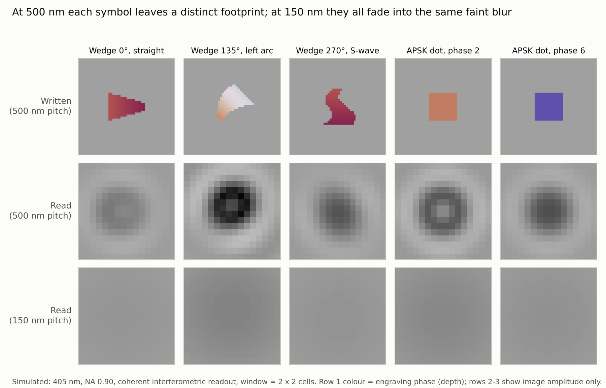
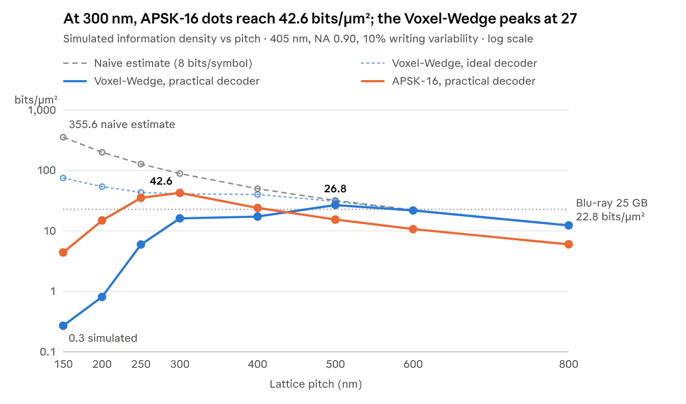
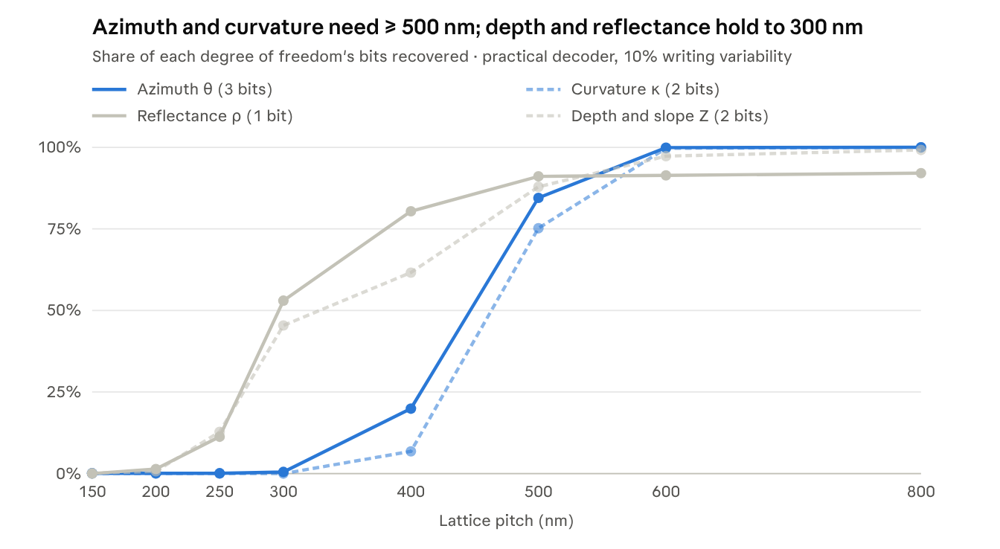
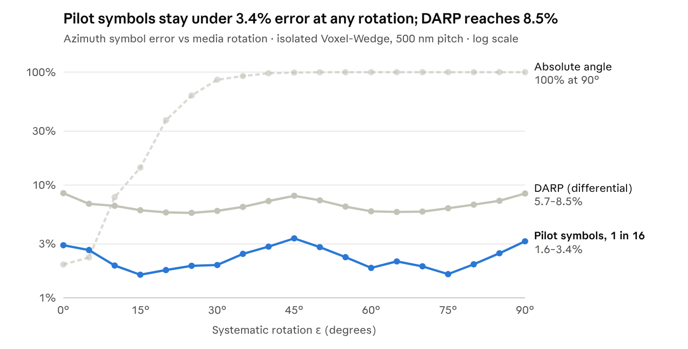
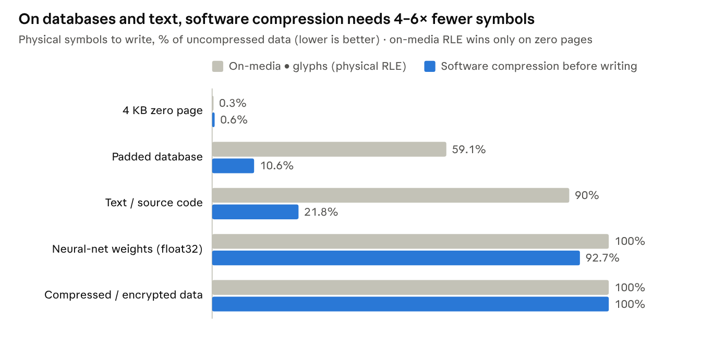
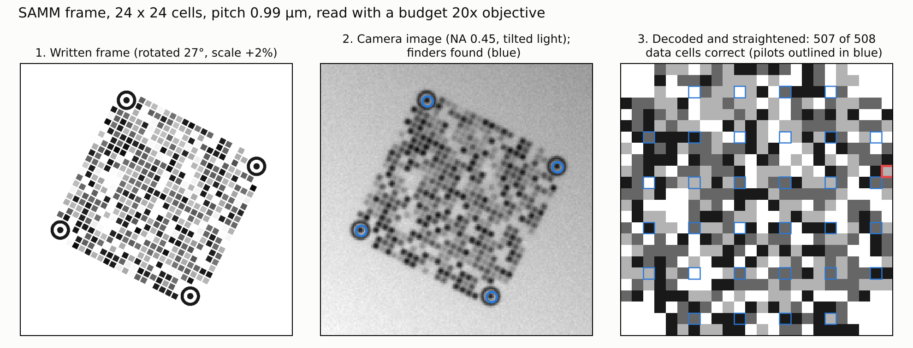
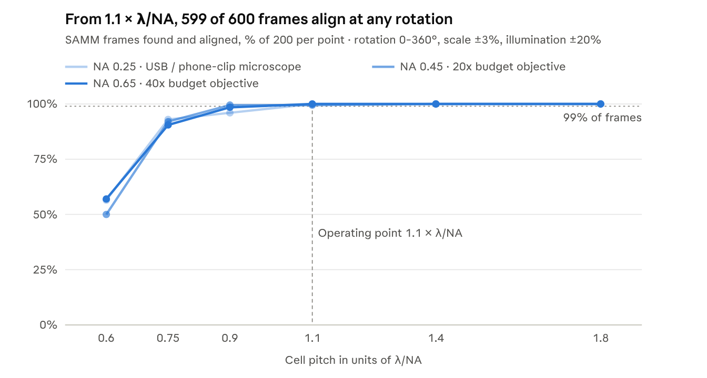

# 4D-VODS White Paper v1.1

Multi-state optical archival storage in glass, with a self-aligning 2D code for low-cost readers: concept and simulation study

**Hakim Guettal** · Version 1.1, November 2026 · Text and figures: CC BY 4.0 · Code: MIT License

*I am not a professional physicist. 4D-VODS started as a geometric intuition (storing data in the shape of engraved symbols) and grew into this conceptual study and simulator, built with the help of AI tools on standard diffraction optics. Corrections from specialists are very welcome.*

Nov 15, 2026 · @Hakim

## 1. Executive summary

4D-VODS is a concept for archival data storage in glass with two layers: a high-density data layer for laboratory-grade readers, and a self-aligning 2D code (SAMM) that a low-cost microscope camera can read at any rotation. Simulation puts the data layer at about 43 bits/µm² (≈ 47 GB per layer on a 12 cm disc) and the low-cost layer at 3.75 bits/µm², with 599 of 600 randomly rotated test frames aligned and decoded.

- **Data layer.** Small square dots (0.6 p, below the optical resolution) carrying 16 phase and amplitude levels (APSK-16) at 300 nm pitch deliver 42.6 bits/µm² before error correction. Net of pilots and error correction this is roughly 35 bits/µm², about 1.15× a BDXL layer (30.5 bits/µm² of user data) – an estimate until the error-correction budget is simulated. The more ambitious 8-bit "Voxel-Wedge" symbol only works from 500 nm pitch (26.8 bits/µm²), because its shape-encoded bits do not survive the diffraction limit.

- **Low-cost layer (SAMM).** Four rotation-invariant bullseye finders and 1-in-16 pilot cells let an ordinary bright-field reader find, orient and decode a frame with no precision stage. At a pitch of 1.1 × λ/NA, 599 of 600 test frames align across three reader classes (NA 0.25 to 0.65), with 0.02–0.25% symbol error.

- **Rotation handling.** Pilot symbols beat differential angle coding (DARP): 1.6–3.4% versus 5.7–8.5% symbol error at any rotation.

- **Compression.** Software compression before writing needs 4–6× fewer symbols than on-media run-length glyphs on databases and text. **Robustness:** these conclusions hold from 5% to 20% writing variability, and the headline densities move by less than 1% between independent random seeds (section 14).

- **Recommendation.** Proceed to a literature and patent check, a stricter simulator, and one write-and-read experiment on glass before any further design commitment.

## 2. Document status

This is version 1.1 (November 2026), written before the project starts: a concept at Technology Readiness Level 2 (concept formulated, checked only in simulation). No sample has been written or read yet.

- **What is simulated.** Coherent and incoherent imaging at the diffraction limit, shot noise, writing variability, inter-symbol interference, random rotation, scale and illumination errors, and practical decoders.

- **What is not.** Real laser-material interaction, vectorial optics at high NA, focus and tilt errors, multilayer cross-talk, read and write speed, cost.

- **Companion document.** The *4D-VODS Technical Note TN-001* gives the formats, parameters and test plan.

Every number here comes from the open simulator described in the appendix or from a cited source.

**Changes in version 1.1.** No result changes. Version 1.1 corrects five points of version 1.0, listed in ERRATA.md in the repository: the APSK-16 dot is a 0.6 p square; densities are stated before error correction and compared with the net user data of Blu-ray and BDXL instead of "1.9× a Blu-ray layer"; the error-correction target now meets its own 15% overhead limit; the physical medium of each layer is declared (section 6); and the NA 0.25 reader is an entry-level 10× objective, with SAMM pitches given at 405 nm. The repository now also records the provenance of every result, checks the optics against closed-form diffraction theory, and checks every number quoted here against the results.

## 3. The problem

Most stored data is written once and rarely read, yet it sits on media that wear out and must be copied to new media every few years, with power, cost and risk at each migration. Laser-written glass removes the migration problem, and Microsoft reports data lifetimes [beyond 10,000 years](https://www.microsoft.com/en-us/research/blog/project-silicas-advances-in-glass-storage-technology/) for its glass voxels. The open problem is the reader.

- **Archives outlive their readers.** A medium that lasts centuries is only useful if someone can still build a reader. Today's glass and ceramic systems rely on precision optics, motion stages and trained decoders.

- **Reader cost limits who can use the medium.** A library, a hospital or a field technician will not own a laboratory instrument.

- **4D-VODS's angle.** Pair a high-density layer for the data centre with a code that a cheap microscope camera can read without alignment, so that critical data and the instructions to decode the rest stay readable with simple equipment.

## 4. Where it is useful

The high-density layer targets bulk archives that are written once and kept for decades; the low-cost SAMM layer opens uses where the reader must be cheap, portable or rebuildable.

| Use case                                                                                                    | Why 4D-VODS fits                                                                                    | Layer      |
|-------------------------------------------------------------------------------------------------------------|-----------------------------------------------------------------------------------------------------|------------|
| Data-centre cold archive (backups, AI training sets, model checkpoints kept for audit)                      | No power at rest, no media migration, written once                                                  | Data layer |
| National archives, libraries, film and cultural heritage                                                    | Centuries-scale lifetime; the SAMM layer can carry the format description needed to decode the rest | Both       |
| Legal and regulatory retention (financial records, audit logs)                                              | Physically unalterable once written, which suits write-once compliance rules                        | Data layer |
| Medical and genomic records                                                                                 | Long retention periods, offline and tamper-evident                                                  | Both       |
| Scientific data (physics, astronomy, climate)                                                               | Large, rarely read, must stay readable for re-analysis                                              | Data layer |
| Air-gapped disaster recovery                                                                                | Cannot be encrypted or deleted by ransomware once written                                           | Data layer |
| Product marking and anti-counterfeiting (aircraft parts, pharmaceuticals, luxury goods, artworks)           | A microscopic code in glass, sapphire or ceramic, read at any orientation by a handheld reader      | SAMM       |
| Data stored on the object itself (serial and calibration data, manuals on a sensor window or watch crystal) | Survives the object's lifetime; read with a low-cost microscope                                     | SAMM       |
| Time capsules and off-world archives                                                                        | No electronics needed to keep the data; simple optics to read it                                    | Both       |

The product-marking and on-object uses depend only on the SAMM layer, which needs no new reader technology. They are the most likely first application.

## 5. State of the art

The closest work is Microsoft's Project Silica, which already reads multi-state symbols in glass with a camera and decodes them with neural networks. 4D-VODS must be positioned against it, and its candidate novelty lies in the low-cost, self-aligning reading layer rather than in glass storage itself.

| Work                                                                                                                                                                                                 | What it does                                                                                                                                                | Relation to 4D-VODS                                                                                                                                        |
|------------------------------------------------------------------------------------------------------------------------------------------------------------------------------------------------------|-------------------------------------------------------------------------------------------------------------------------------------------------------------|------------------------------------------------------------------------------------------------------------------------------------------------------------|
| [Microsoft Project Silica](https://www.microsoft.com/en-us/research/blog/project-silicas-advances-in-glass-storage-technology/) ([Nature paper](https://pmc.ncbi.nlm.nih.gov/articles/PMC12916313/)) | Femtosecond-laser birefringent and phase voxels in glass; wide-field microscope readout; CNN decoding; machine-learned symbol encodings; borosilicate glass | Already covers multi-state symbols, page readout and learned decoding. Silica's move to phase voxels agrees with our APSK-16 result                        |
| 5D optical storage (University of Southampton)                                                                                                                                                       | Nanogratings in glass; slow-axis orientation and retardance read with polarised light                                                                       | Orientation stored as an optical property rather than a shape, so it stays readable where shapes blur                                                      |
| [Cerabyte](https://blocksandfiles.com/?p=54840)                                                                                                                                                      | Femtosecond-laser holes in a ceramic layer on glass, QR-like data matrices read by camera; electron-beam readout below the diffraction limit                | Already covers camera page readout. Pilot at 100 MB/s, target above 2 GB/s around 2030 ([source](https://www.techpowerup.com/forums/goto/post?id=5548458)) |
| Holographic storage (2000s)                                                                                                                                                                          | 2D data pages read by a camera                                                                                                                              | Prior art for page-based readout                                                                                                                           |
| DPSK (telecommunications)                                                                                                                                                                            | Information carried by the phase difference between consecutive symbols                                                                                     | The principle behind DARP, with its known error penalty                                                                                                    |
| 8b/10b line coding                                                                                                                                                                                   | Out-of-alphabet control ("comma") symbols for synchronisation                                                                                               | Prior art for control glyphs                                                                                                                               |
| QR and Data Matrix codes                                                                                                                                                                             | Printed 2D codes with finder patterns, read by any camera at any rotation                                                                                   | The model for SAMM, which is more than five orders of magnitude denser                                                                                     |

Rows without links are general knowledge of the field and need specific references before publication.

## 6. System concept

4D-VODS writes two kinds of region on the same glass medium with the same femtosecond laser: dense data frames for a laboratory reader, and self-aligning SAMM frames for a low-cost reader.

|                                                    | High-density data layer                                                   | SAMM layer (low-cost)                                                      |
|----------------------------------------------------|---------------------------------------------------------------------------|----------------------------------------------------------------------------|
| Purpose                                            | Bulk archive                                                              | Indexes, format description, critical records, product marking             |
| Symbol                                             | Isotropic dot, 8 phase × 2 reflectance levels (APSK-16, 4 bits)           | Square dot, 4 reflectance levels (2 bits)                                  |
| Pitch                                              | 300 nm                                                                    | 1.1 × λ/NA of the reader (0.69 µm at NA 0.65)                              |
| Reader                                             | Interferometric (amplitude and phase), NA 0.90, 405 nm, positioning stage | Bright-field microscope camera, NA 0.25–0.65, LED or laser diode, no stage |
| Alignment                                          | Pilot symbols, mechanical positioning                                     | Bullseye finders + pilots, any rotation, ±3% scale                         |
| Simulated density                                  | 42.6 bits/µm²                                                             | 3.75 bits/µm² at NA 0.65                                                   |
| Capacity per 12 cm disc-equivalent area, one layer | ≈ 47 GB                                                                   | ≈ 4 GB                                                                     |

**Physical medium (declared in version 1.1).** The two regions use different contrast mechanisms. The SAMM layer is a thin absorbing film (metal, nitride or ceramic) on the glass surface, removed by laser ablation; grey levels are set by the fraction of each cell that is ablated, in features finer than the reader resolves. This gives the amplitude contrast a bright-field camera needs, which a change inside bulk glass, mostly a phase change, would not. The film must be protected by a durable material or a bonded cover glass, a choice still open. The high-density layer is modelled as a reflective relief: a metallised relief sealed under a cover layer, as in a pressed optical disc. Under a cover of index n the same phases need depths divided by n (27 and 62 nm instead of 40 and 90 nm for n = 1.46), and the results are unchanged. Writing the same eight phase levels inside bulk glass is not covered by these results: with an index change of 0.005–0.02 the deepest level needs a voxel 10–38 µm long, against a depth of focus of 0.5 µm at NA 0.90.

A medium can hold many data layers stacked in depth, as Silica does; this study simulates one layer only. The SAMM layer sits at a known, accessible depth so a simple reader can focus on it.

## 7. Symbol alphabets studied for the data layer

Two data-layer alphabets were compared under identical optics: the original Voxel-Wedge idea (256 states, 8 bits) and simpler isotropic dots (16 states, 4 bits).

**Voxel-Wedge.** An asymmetric engraving with a broad head and a narrow tail. Its shape scales with the pitch p: length 0.75p, head 0.6p, tail 0.17p, maximum lateral tail deflection 0.12p (at p = 150 nm: a 90 nm head and a 25 nm tail). The byte is split as \[b7 b6 b5 \| b4 b3 \| b2 b1 \| b0\].

| Degree of freedom | Bits | States                                       | How it is modelled                                     |
|-------------------|------|----------------------------------------------|--------------------------------------------------------|
| Azimuth θ         | 3    | 8 orientations, 45° apart                    | Rotation of the head-to-tail shape                     |
| Depth and slope Z | 2    | 40 or 90 nm stratum × rising or falling ramp | Phase 4πh/λ, with depth h varying ±25% along the wedge |
| Curvature κ       | 2    | Straight, left arc, right arc, S-wave        | Deflection of the centre line                          |
| Reflectance ρ     | 1    | Specular or diffuse floor                    | Floor amplitude 1.0 or 0.5                             |

**APSK-16 (isotropic dots).** A square dot of side 0.6p with no orientation, carrying 8 phase levels (different depths) × 2 reflectance levels = 16 states, 4 bits. APSK stands for amplitude and phase-shift keying, the constellation used in satellite links, applied here to an engraved dot. It is close in spirit to Silica's phase voxels.

*Figure: at 500 nm pitch each symbol leaves a distinct footprint in the reader's image; at 150 nm every symbol fades into the same faint blur (make_illustrations.py).*

## 8. Simulation method

The simulator writes random symbols on a lattice, images them through realistic optics, adds noise, decodes, and measures how much information comes back. The code is open (appendix).

- **Data-layer optics.** 405 nm, NA 0.90, coherent illumination, scalar Fourier optics: the image is the reflected field low-pass filtered by a circular pupil of cut-off NA/λ. The matching resolution limit is d = λ / (2·NA) = 225 nm.

- **Data-layer readout.** Interferometric: the camera measures amplitude and phase, 8 × 8 pixels per symbol.

- **Read noise.** Shot noise at 64,000 photons per symbol (about 1,000 per pixel); 6,400 and 640,000 tested for sensitivity.

- **Writing variability.** Each written symbol gets a random complex error of 10% in amplitude and phase. The "ideal" configuration sets it to zero.

- **Trials.** 7 × 7 grids of random symbols; only the central 3 × 3 are scored, so every scored symbol has neighbours on all sides. 2,000 trials (18,000 symbols) per pitch and configuration.

- **Practical decoder.** Template matching against all symbol models, then 3 rounds of interference cancellation: estimate the neighbours, subtract them, decode again.

- **Ideal decoder.** As above with the neighbours known. Not realisable: it bounds what any joint or neural decoder could achieve on the same images.

- **Metric.** Bits per symbol = sum of the mutual information recovered on each degree of freedom, a lower bound on capacity. Density = bits per symbol / p². Capacity per layer:

*C*(GB) = ρ · *A* / (8 × 10⁹),  with *A* = π (58² − 24²) mm² = 8.76 × 10⁹ µm²

With ρ in bits/µm², each bit/µm² is worth about 1.1 GB per layer of a 12 cm disc. Capacities are before error correction, which typically costs another 10–15%. The Blu-ray (25 GB, 22.8 bits/µm²) and BDXL (33.4 GB, 30.5 bits/µm²) figures quoted for comparison are net user data. The SAMM layer uses its own simulator, described in section 13.

## 9. Result 1: effective density vs pitch

Below 300 nm the Voxel-Wedge collapses because its shape information never reaches the sensor; it peaks at 500 nm. Isotropic APSK-16 dots do better from 250–300 nm.

vods_sim.py v0.1 · 8 pitches, 18,000 symbols per point · 12 cm disc, data zone 24–58 mm

A hundredfold change in photons barely matters: at 500 nm density moves from 28.8 to 29.7 bits/µm² (ideal writing). The limit is interference between neighbouring symbols, not noise. The ideal-decoder curve shows what a better joint decoder could recover: about 40 bits/µm² at 300–400 nm, still far below the naive 8-bits-per-symbol estimate.

| Configuration                                         | Capacity per layer (12 cm disc) |
|-------------------------------------------------------|---------------------------------|
| Naive estimate, Voxel-Wedge at 150 nm (8 bits/symbol) | ≈ 390 GB                        |
| APSK-16 at 300 nm (simulated)                         | ≈ 47 GB                         |
| Voxel-Wedge at 500 nm (simulated)                     | ≈ 29 GB                         |
| Blu-ray, net user data (reference)                    | 25 GB                           |
| BDXL, net user data (reference)                       | 33.4 GB                         |

Simulated rows are before error correction; the two references are net user data. Net of pilots (1 in 16) and the error-correction target of TN-001 (overall code rate ≈ 0.88), APSK-16 at 300 nm would hold about 39 GB per layer (≈ 35 bits/µm²), about 1.15× BDXL. This net figure is an estimate until test T2 is run.

## 10. Result 2: which degrees of freedom survive

Shape-encoded information dies first: at 400 nm the azimuth delivers 20% of its bits and the curvature 7%. Reflectance and depth, which are properties of the field rather than of the shape, hold down to 300 nm.

vods_sim.py v0.1 · mutual information per degree of freedom / maximum bits · 18,000 symbols per point

This explains Result 1. A 25 nm shape cannot pass through optics that resolve 225 nm, while a phase or reflectance level reaches the sensor even when the shape is blurred. Reflectance stays near 92% even at large pitches because of the writing variability: about 1% of symbols get this bit wrong, against none without variability.

## 11. Result 3: rotation, DARP and pilot symbols

Differential angle coding (DARP) does cancel rotation, but every misread corrupts two consecutive differences, so it makes about 3× more errors. One known pilot symbol every 16 estimates the rotation, is just as immune, and errs far less.

vods_sim.py v0.1 · 400 rows of 64 symbols per angle · noise set for ≈ 2% error at ε = 0

Pilots cost one symbol in 16 (6.25% of capacity), the same order as one anchor per row. The small 45°-period ripple comes from the pixel grid, which is not perfectly isotropic.

**Gray coding.** In the 500 nm lattice, 66% of azimuth errors fall on the adjacent angle (±45°). With natural binary mapping an adjacent error flips 1.75 bits on average; with Gray coding it flips one. In this figure's experiment (ε = 0) the bit error rate drops from 1.05% to 0.76% (−28%) at no cost.

## 12. Result 4: on-media compression glyphs vs software compression

Run-length glyphs on the medium only pay off on long runs of identical bytes: a 4 KB zero page takes 13 symbols against 26 for zlib. On real data, compressing in software before writing wins clearly.

vods_sim.py v0.1 · rule: \[S\] + k • glyphs = 2^k copies of S · software = best of zlib level 9 and LZMA

Run-length coding only sees repeats of the same byte, while zlib and LZMA find any repeated sequence. Neural-network weights (synthetic, normally distributed here) and already-compressed or encrypted data are nearly incompressible for any method. The • and ◦ glyphs are therefore kept as structural markers, not as compression (section 15).

## 13. Result 5: a self-aligning micro-matrix (SAMM) for low-cost readers

A SAMM frame can be found, oriented and decoded by an ordinary bright-field microscope camera with no stage and no knowledge of its rotation. At a cell pitch of 1.1 × λ/NA, 599 of 600 test frames aligned across the three reader classes, with symbol error rates of 0.02–0.25%; at 1.4 × λ/NA none of 600 failed.

**Frame design.** 24 × 24 cells. A 3 × 3-cell bullseye (dark centre dot and dark ring) sits in each corner; it looks the same at every angle, so one correlation finds it. Every cell whose row and column are both 2, 6, 10… is a pilot with a known pseudo-random level (1 cell in 16). The other 508 cells carry data as square dots with 4 reflectance levels (2 bits, Gray coded): 127 bytes per frame, 88% of the cells.

**Reader model.** Incoherent bright-field imaging at 405 nm; NA 0.25, 0.45 or 0.65; camera pixel λ/(4·NA); 2% sensor noise; illumination tilted by up to ±20%; random rotation (0–360°), scale (±3%) and position; writing variability of 0.03 in reflectance.

**Decoding.**

1.  Flatten the illumination, correlate the image with the bullseye template, and keep up to five groups of four peaks that form a square.

2.  For each group, try the 8 corner assignments (4 rotations × mirror), fit an affine transform, and keep the one whose pilot cells best match the known pattern.

3.  Fit the illumination tilt and the four grey levels from the pilots.

4.  Classify every data cell, then cancel the measured neighbour interference twice and classify again.

*Figure: one simulated SAMM frame at 0.99 µm pitch; the decoder finds the four finders (blue), straightens the frame and recovers 507 of 508 data cells (the error is outlined in red).*

samm_sim.py v0.1 · 200 frames per point, 3 reader classes, 6 pitches

Below 0.9 × λ/NA alignment degrades quickly as the optics blur neighbouring cells together: 90–93% of frames at 0.75 and 50–57% at 0.6. Results scale with λ/NA, so the same frame specification serves any reader. Operating points at 1.1 × λ/NA:

| Reader class              | NA   | Cell pitch | Frames aligned (95% CI) | Symbol error | Net density   | Capacity    |
|---------------------------|------|------------|-------------------------|--------------|---------------|-------------|
| Entry-level 10× objective | 0.25 | 1.78 µm    | 200/200 (98.1–100%)     | 0.02%        | 0.55 bits/µm² | ≈ 7 MB/cm²  |
| Budget 20× objective      | 0.45 | 0.99 µm    | 199/200 (97.2–99.9%)    | 0.25%        | 1.77 bits/µm² | ≈ 22 MB/cm² |
| Budget 40× objective      | 0.65 | 0.69 µm    | 200/200 (98.1–100%)     | 0.02%        | 3.75 bits/µm² | ≈ 47 MB/cm² |

For scale: a printed QR code (version 40, 0.25 mm modules) holds about 0.00001 bits/µm² by our calculation, so SAMM at NA 0.65 is about 300,000× denser while staying readable by a similar find-and-align logic. Error correction (not yet modelled) is expected to clean up the residual 0.02–0.25% symbol errors and the rare frame that fails to align is simply re-imaged.

Pitches and densities in this section are given at 405 nm. The SAMM image depends only on the pitch in units of λ/NA (checked in the repository's validation report), so alignment and error rates hold at any wavelength. With white-LED light (about 550 nm) the pitches grow by 550/405 and the densities shrink by about 0.54×.

## 14. Result 6: robustness to the assumptions

Halving or doubling the two main assumptions moves the numbers but not the conclusions: APSK-16 beats the Voxel-Wedge at every level tested, and SAMM frames keep aligning.

**Data layer: writing variability.** Best density over the 8 simulated pitches, practical decoder:

| Writing variability | APSK-16                 | Voxel-Wedge             |
|---------------------|-------------------------|-------------------------|
| 5%                  | 44.4 bits/µm² at 300 nm | 29.2 bits/µm² at 500 nm |
| 10% (baseline)      | 42.6 bits/µm² at 300 nm | 26.8 bits/µm² at 500 nm |
| 20%                 | 33.0 bits/µm² at 300 nm | 19.6 bits/µm² at 500 nm |

At 20% the Voxel-Wedge falls below the net user density of a Blu-ray layer (22.8 bits/µm²), while APSK-16 stays 1.4× above it. Repeating the two baseline points with 5 further random seeds gives 42.56 ± 0.07 and 27.01 ± 0.15 bits/µm² (mean ± standard deviation), so simulation noise is well below 1%.

**SAMM layer: camera noise and writing variability doubled.** NA 0.45 reader, pitch 1.1 × λ/NA, 120 frames per case:

| Case                                  | Frames aligned | Symbol error |
|---------------------------------------|----------------|--------------|
| Baseline (2% noise, 0.03 variability) | 120/120        | 0.01%        |
| Camera noise × 2                      | 118/120        | 1.7%         |
| Writing variability × 2               | 120/120        | 2.1%         |
| Both × 2                              | 120/120        | 3.8%         |

Alignment holds; symbol errors rise to a few percent, which calls for stronger error correction than the RS(127, 119) code proposed in the technical note, or 3 grey levels instead of 4. At 1.4 × λ/NA every frame aligned in all four cases (symbol error ≤ 3.1%).

## 15. Proposed architecture and candidate contributions

The results lead to one rule: phase and amplitude carry the data, geometry carries the structure. Shapes are used only for what they do well, namely being found and oriented.

| Element                        | v1.0 choice                                                                          | Basis                                                                           |
|--------------------------------|--------------------------------------------------------------------------------------|---------------------------------------------------------------------------------|
| Data symbol                    | Isotropic APSK-16 dot, 300 nm pitch                                                  | 42.6 bits/µm² with a practical decoder (section 9)                              |
| Robust data mode               | Voxel-Wedge, 8 bits, 500–600 nm pitch                                                | 22–27 bits/µm² with a simple decoder                                            |
| Low-cost layer                 | SAMM frames, 4-level dots, pitch 1.1 × λ/NA                                          | 599 of 600 frames aligned, 0.02–0.25% symbol error at NA 0.25–0.65 (section 13) |
| Finder                         | Rotation-invariant bullseye in each frame corner                                     | Found by one correlation, no angle search                                       |
| Orientation and calibration    | Known pilot cells, 1 in 16                                                           | Resolve rotation and mirror, fit grey levels and illumination                   |
| Rotation handling (data layer) | Pilot symbols; differential coding optional                                          | About 3× fewer errors than DARP (section 11)                                    |
| Bit mapping                    | Gray code on phase, azimuth and grey levels                                          | −28% bit errors at no cost (section 11)                                         |
| Compression                    | Software (zstd or LZMA) before writing                                               | 4–6× fewer symbols than on-media glyphs (section 12)                            |
| Error correction               | Soft-decision LDPC (rate ≈ 0.94) inside, RS(255, 239) outside, ≈ 12% parity in total | Uses the decoder's confidence, not just its decision                            |

**Candidate original contributions**, to be checked against patents and literature before being claimed:

1.  **A two-tier glass medium** in which a self-aligning low-cost layer carries the index and the format description needed to decode the high-density layer.

2.  **SAMM frames scaled to the reader's optics**, with pitch set as a multiple of λ/NA so one specification serves entry-level (NA 0.25) to laboratory (NA 0.65) readers.

3.  **A pitch-adaptive alphabet** that enables shape-based degrees of freedom only above the pitch where they survive (section 10).

4.  **Directional wedge pilots** as an optional orientation key for partially visible frames.

## 16. Limitations and open assumptions

Read the results as comparisons between options under the same conditions, not as predictions of a device's performance.

- **Optimistic writing.** Shapes are engraved exactly as drawn. Real heat-affected zones round off a 25 nm tail or a curvature arc, so shape-based degrees of freedom would do worse than simulated.

- **Scalar optics.** At NA 0.90, vectorial and polarisation effects matter and are ignored, as are focus, tilt and cross-talk between layers.

- **Conservative decoders.** A trained neural decoder would land between the practical and ideal curves.

- **10% writing variability, 2% camera noise.** Both are assumptions. Section 14 shows the conclusions hold at half and double these values, but measured values are still needed.

- **SAMM frames are small.** The simulated frame is 24 × 24 cells (127 data bytes). Larger frames reduce finder overhead but need flatter fields of view; this trade-off is untested.

- **No speed or cost model.** The simulation says how much information is recoverable, not how fast it is written or read, or at what price.

## 17. Roadmap

The next step is a stricter simulation, then a single experiment on real glass decides whether the project is worth pursuing.

1.  **Simulator v0.2.** Shape errors in writing, vectorial optics, a neural decoder, APSK-32/64, larger SAMM frames, defocus. Go criterion: APSK at 300 nm stays above 35 bits/µm² and SAMM keeps ≥ 99% alignment.

2.  **Literature and patent search** (Espacenet, Google Patents, Google Scholar) on the four candidate contributions. Go criterion: at least one is not covered by existing work.

3.  **Partner with a university femtosecond micromachining lab**, using this paper and the simulator as the basis of the proposal.

4.  **Glass experiment.** Write APSK test grids at 300 and 400 nm and SAMM frames for NA 0.25, 0.45 and 0.65; read them with a microscope and a USB microscope. Measure symbol error and real writing variability.

5.  **Calibrate** the simulator with the measured values and re-run every curve.

6.  **Publish** as a preprint (arXiv, physics.optics and cs.IT) or at an optical data storage conference such as SPIE ODS.

## 18. Appendix: reproducibility and sources

Every number and figure in this paper is produced by the open-source repository github.com/Guett-HM/*4d-vods* (code: MIT License; text and figures: CC BY 4.0). A full run takes about one hour on a 2-core computer with Python 3, numpy, scipy and matplotlib.

pip install -r requirements.txt \# exact versions: requirements-lock.txt  
pytest -q \# ~50 tests, about 1 minute  
python -m vods validate --report \# optics vs closed-form theory -\> docs/VALIDATION.md  
python -m vods check \# every number quoted here vs results/  
python -m vods run datalayer --config configs/datalayer.toml  
python -m vods run samm --config configs/samm.toml  
python -m vods run samm --config configs/samm_sensitivity.toml  
python -m vods figures \# figures (PNG, PDF, CSV) and results/summary.json

Random seeds are fixed, so results are identical on every run. Every result file records the command, commit and software versions that produced it (results/MANIFEST.json), and every number quoted in this paper is traced to a result field and checked automatically (results/claims.json).

**How to cite.** Guettal, H. (2026). *4D-VODS: optical data storage in glass with a self-aligning code for low-cost readers*, version 1.1.0. Zenodo. https://doi.org/10.5281/zenodo.24268721

**Use of AI tools.** AI assistants helped write the simulator and these documents. All results come from the code in the repository and can be checked by re-running it.

**Sources**

- [Silica: archival data storage in glass – Nature, full text on PMC](https://pmc.ncbi.nlm.nih.gov/articles/PMC12916313/)

- [Microsoft Research – Project Silica's advances in glass storage technology](https://www.microsoft.com/en-us/research/blog/project-silicas-advances-in-glass-storage-technology/)

- [Blocks & Files – Cerabyte roadmaps ceramic nano-memory storage](https://blocksandfiles.com/?p=54840)

- [TechPowerUp – Cerabyte speed targets and pilot system](https://www.techpowerup.com/forums/goto/post?id=5548458)

- [AnandTech – Sony releases quad-layer 128 GB BD-R XL media (BDXL: 33.4 GB per layer)](https://www.anandtech.com/show/13575)
